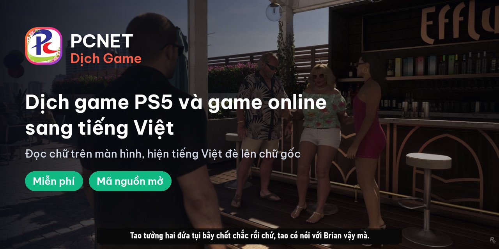

## Xin chào, mình là PCNET 👋

Kênh YouTube game **PCNET**: chơi, review và livestream việt hóa game PS5.

### 🎮 Đang làm: [PCNET Dịch Game](https://github.com/pcnetdl/dich-game)

Phần mềm dịch game PS5 và game online trên PC sang tiếng Việt: đọc chữ trên màn hình rồi hiện tiếng Việt đè ngay lên chữ gốc, lúc mình đang chơi. **Miễn phí và mã nguồn mở.**

Đang chạy thử. Gần ngày GTA 6 ra mắt (19/11/2026), mã nguồn và bản cài sẽ được đăng để anh em tải về dùng thử. 👉 **[Xem chi tiết và bấm Star để không lỡ bản tải](https://github.com/pcnetdl/dich-game)**

### Theo dõi và ủng hộ

- 📺 YouTube: [@pcnetdl](https://www.youtube.com/@pcnetdl) · TikTok: [@pcnetdl](https://www.tiktok.com/@pcnetdl)
- 🌐 Tin game: [pcnetdl.com](https://pcnetdl.com)
- 💝 Donate ủng hộ kênh: [pcnetdl.com/donate](https://pcnetdl.com/donate)
- ☕ Cà phê KA FRESH / trà FUTRA trên Shopee: [pcnetdl.com/cafe](https://pcnetdl.com/cafe) — *link tiếp thị liên kết: bạn mua thì kênh có thêm chút hoa hồng, giá không đổi*
